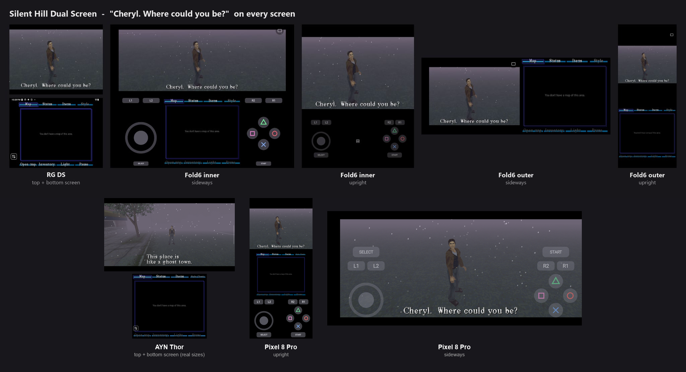
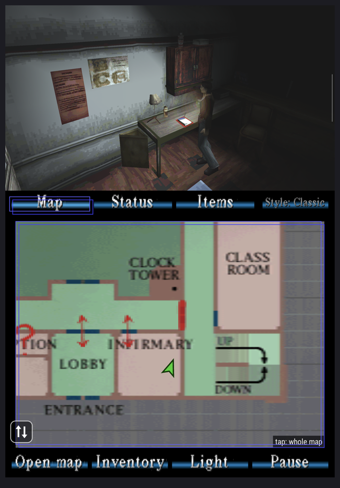
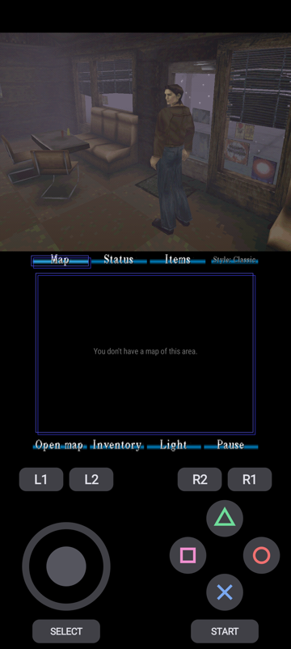

# Silent Hill - Dualscreen

A dual-screen mod for the **Silent Hill (1999) Android port**.
The game plays on one screen. A live map, your status and your items sit on the other.

It also runs on regular phones and foldables, with touch buttons.

**This is a fan project. It is not made or approved by Konami.**

---

## ⚠️ You need your own copy of the game

**This app has no game files in it.** You must own Silent Hill for the PlayStation.

- Version: **Silent Hill (USA)**, the PlayStation 1 disc
- Files: the disc image, as **`.bin` + `.cue`**
- Make the image from your own disc.

**Please don't ask for game files.** They won't be shared here, and issues asking for them will be closed.

---

## Install

1. Download the newest **APK** from the [Releases](../../releases) page.
2. Open it on your device and allow the install.
3. Copy your `.bin` and `.cue` into the **`Download/gamedata`** folder on your device.
   Make the `gamedata` folder if it's not there.
4. Open the app. Allow **"All files access"** when asked. This lets it find the game in Download.
5. On a dual-screen device, allow **"Display over other apps"** if asked. This shows the menu on the second screen.

> **Screen stays black the first time?** Close the app fully and open it again.
> This can happen right after you allow file access. It only happens once.

### Updating

**Install the new APK over the old one.** Your saves stay.

> **Had a test build from us before v1.0?** Those used a different signature.
> Back up your saves, uninstall once, then install v1.0. After that, updates install normally.

### Back up your saves

Saves live in `Android/data/com.silenthill.pc/files/gamedata/save/`.

> ⚠️ **Uninstalling deletes your saves.** Copy that folder somewhere safe first.

---

## What it works on

| Device | What you get |
|---|---|
| **AYN Thor** | Game on the top screen. Map, status and items on the bottom. |
| **Anbernic RG DS** | The same, on two 4:3 screens. |
| **Galaxy Z Fold** | Unfolded: game + menu + touch buttons side by side. |
| **Regular phone** | Upright: game, menu and touch buttons. Sideways: full screen with touch buttons. |

- Needs **Android 7 or newer**, 64-bit (arm64).
- A controller works everywhere. Touch buttons hide when one is connected on the Fold.

---

## The second screen

- **Map:** the real paper map, with Harry's position live. Tap for the whole map.
- **Status:** how hurt Harry is, like the game's own status screen.
- **Items:** tap an item to use it. Weapons equip, health items heal.
  The flashlight and radio switch on and off. Keys open the item menu with "Use" ready.
- **Style:** *Classic* (art from the disc) or *Remake*.
- **Bottom buttons:** Open map, Inventory, Light, Pause.

### Controller

- **Right stick:** move through the bottom screen. Left and right change page. Up and down pick an item.
- **R3** (press the right stick): use the item, or zoom the map.
- **L3** (press the left stick): change the camera.

### Screen controls

- **⇅ button:** swap screens, or hide the second screen.
- **Hold Back** (about 1 second): cycles swap, hide, and back to normal.

---

## Known issues

- **Black screen on the very first start**, right after allowing file access. Close and reopen the app.
- **Some places run slower on the RG DS** than on the Thor, like the opening cafe.
- **Game sound may be a bit quiet** next to the movies.
- **Only the USA disc** is tested.

Found something else? Please report it. 💛

---

## Report a bug

Open an **[Issue](../../issues)**. Please include:

- your device and Android version
- the app version (shown in Android's app info)
- what happened, and where in the game

A screenshot or short video helps a lot.

---

## Credits

This mod stands on a lot of other people's work. Thank you all.

- **[Vatuu and the Silent Hill decomp team](https://github.com/Vatuu/silent-hill-decomp)**: turned the PS1 game back into readable code.
- **[SlickAmogus](https://github.com/SlickAmogus/silent-hill-decomp)**: the native PC port built on the decomp.
- **[WhoisMiau0x1](https://github.com/WhoisMiau0x1/Silent-Hill-1999-Android-port)**: the Android port this mod starts from.
- **PsyCross** (REDRIVER2 project): makes PS1 graphics run on modern devices.
- **SDL2** and **OpenAL Soft**: controls, screen and sound.

**This mod:** TheYellowBee and OffensiveNeon.
The dual-screen menu, phone and foldable support, the RG DS fixes, and fixes for newer Android phones.

**Built with help from Claude** (Anthropic's AI). We test every release on real devices.

Licenses for the parts above: [THIRD-PARTY-NOTICES.md](THIRD-PARTY-NOTICES.md).

---

## Legal

Silent Hill is a trademark of Konami. This project is not linked to Konami.
No game data from the original disc is included. You bring your own.
